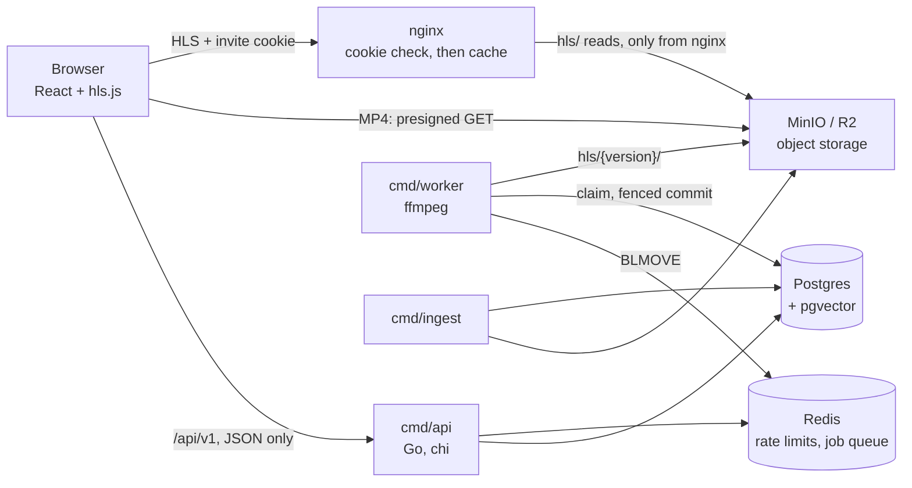

# GoalStream

A football highlights streaming platform in Go. Clips are cut from full broadcast matches, stored
in object storage and delivered straight from storage by presigned URLs. Delivery was later
upgraded to adaptive HLS **on the running system, per clip and reversibly**, through a transcoding
pipeline that survives crashes. A content-based recommender picks the next clip.

The hard parts are not the video player. They are keeping media bytes out of the API, transcoding
in the background without losing or duplicating work, and changing how a live system delivers
video without breaking it.

> Dataset used under research NDA (SoccerNet), not publicly redistributed. No media or
> annotation file is ever committed to this repository. Design notes and the plan live in a local,
> untracked `docs/`. The full build log, milestone by milestone, is in
> [MILESTONES.md](MILESTONES.md).

## What it achieved

Everything here was measured on this system, not estimated. How each number was measured is in
the milestone linked after it.

- **Slow connections stopped freezing.** On a throttled "Slow 4G" link, the same 10 clips froze
  76 times as MP4, almost 7 minutes of frozen video in total. As HLS they never froze once. The
  catch is a slower start: the first frame takes about 7 seconds instead of 3, because HLS needs
  a few round trips before it can play anything.
  ([M5](MILESTONES.md#m5--hls-for-one-clip-m5-hls-one-clip))
- **The whole catalogue moved to HLS while the app kept running.** 78 clips, 78 successful
  jobs, every one on its first try: 33 minutes on a single laptop worker. Afterwards a verifier
  checked that every clip still plays.
  ([M7](MILESTONES.md#m7--migrate-the-catalogue-m7-catalog-migrated))
- **Killing the worker loses nothing.** The tests `kill -9` it in the middle of ffmpeg, crash it
  at every step of publishing, wipe Redis mid-run, and let a "zombie" worker wake up late and try
  to publish. No job is lost, none is published twice, and nobody watching a clip ever sees its
  files change. ([M6](MILESTONES.md#m6--async-transcoding-pipeline-m6-pipeline))
- **Repeat views come from the cache.** A second viewer watching at the same quality is served
  entirely from nginx, without touching storage. Across viewers at different qualities it drops
  to 40 %, because each quality level is its own set of files.
  ([M8](MILESTONES.md#m8--caching-layer-local-m8-cache))
- **Video segments are locked down.** Without a valid invite cookie, every segment request gets
  a 403: even one nginx already has cached, and even if you skip nginx and go straight to
  storage. ([M9](MILESTONES.md#m9--segment-access-control-and-hardening-local-m9-hardening))
- **Picking the next clip is quick.** 7 ms at the median and 17 ms at p95, measured through
  the full HTTP stack. ([M4](MILESTONES.md#m4--auth-and-recommender-m4-auth-reco))

## Architecture



- **The API never carries media bytes.** It answers `/play` with a URL; the browser fetches from
  storage directly. The API scales with requests, not bandwidth.
- **Postgres stores metadata, object storage stores bytes.** The bucket is physical truth,
  Postgres is the index. Redis holds no truth: every queued job is a Postgres row.
- **Production** (Render for the API, Postgres and Redis; Vercel for the web app; Cloudflare R2
  for bytes) serves MP4. **Phase B** (HLS, worker, cache, access control) runs on localhost only
  and is shown by screencast: the dataset NDA rules out putting segments on a public origin.

## Problems solved

**Serving video without the API in the way.** If the API streamed video itself, every byte
anyone watched would pass through it, and it would need to scale with bandwidth. Instead, the API
hands the browser a short-lived signed link (a presigned URL, valid for 15 minutes, for one file),
and the browser downloads straight from storage. Seeking works too, because storage already
supports byte-range requests. To be sure of the reasoning, I built the alternative once (M3): a
proxy that serves byte ranges through the API. It works, but every watched byte still crosses the
API, which is exactly what the design avoids.

**Clips that actually contain the goal.** The source is full 45-minute halves plus a timestamp for
each goal. Copying a slice of the file without re-encoding is fast, but it can only cut at a
keyframe, which may land seconds away from the timestamp and miss the goal. So ingest re-encodes
from 15 seconds before the goal to 45 seconds after. Every cut is then checked by fully decoding
it, its bitrate is kept below the broadcast's, and it is uploaded before its database row is
written, so a crash never leaves a row pointing at nothing. The original clip is never deleted:
every later re-encode starts from it, and every rollback returns to it.

**Playback that adapts to slow connections.** An MP4 is one file at one bitrate. If the connection
is slower than the file, the player can only stop and wait. HLS stores each clip at several
quality levels (720p, 480p, 360p), cut into 4-second pieces, so the player can drop to a lower
quality when the connection slows down. The levels are worked out from each clip's own bitrate,
never higher than the source. Keyframes are placed every 2 seconds by time, so the pieces line up
across levels and the player can switch quality mid-clip without a glitch.

**Never showing viewers a half-finished clip.** Converting a clip can crash halfway, be retried,
or keep running after the system has given up on it. Each attempt therefore writes to its own
folder, and the playlist that ties everything together is uploaded last. A clip only switches to
the new version through a single database transaction that checks the job still belongs to that
attempt. A late or replaced attempt finds it no longer owns the job and changes nothing. Switching
versions, and rolling back, is just changing which folder the clip points to.

**Background jobs that survive crashes.** Jobs go through a Redis queue, but the real record of
every job is a row in Postgres. A job can only be taken by updating its row from "waiting" to
"processing", so if two workers get the same job, only one wins. A reaper finds jobs stuck in
"processing" because their worker died and retries them. A crash counts as an attempt, so a file
that crashes the worker every time is eventually marked failed instead of looping forever. The
reaper also re-queues anything Redis lost. A planned shutdown gives its attempt back.

**A cache that never needs clearing.** nginx sits in front of storage and keeps a copy of every
video file for 7 days. That's safe because a version's files never change after they are
written. The only thing that does change is which version a clip plays, and that comes from the
API, which is never cached. The cache also ignores the link's query string, so signed links don't
create duplicate copies.

**Locking down the video files.** The player fetches each piece by a plain address with no
signature, so anything that knew the address could read it. Now nginx checks the visitor's invite
cookie before serving anything, including files it already has cached. Storage itself only
answers requests that come from nginx, so going around nginx doesn't work either. A cookie was
chosen over a per-viewer token in the URL because a token would give every viewer their own
cached copy.

**Recommendations you can explain.** Every clip is described by a 128-number vector (scoring
team, competition, season, kind of goal, minute, home or away), stored with pgvector. For each user the system keeps the
average of the clips they loved and the average of the ones they disliked. Changing a rating
moves one clip's vector from one average to the other. Until a user has rated 5 clips, picks are
random. After that, 70 % of picks are the clips closest to what they loved and furthest from what
they disliked, and 30 % are deliberately different, so they keep discovering new things.

**Accounts and protection against abuse.** Passwords are hashed with argon2id. Logins last 15
minutes and renew themselves with a refresh token that changes on every use; if an old one is
reused, the whole session is revoked as stolen. A Redis rate limiter protects login and the invite
gate, and if Redis is down it refuses those requests rather than letting them through. Every route
sits behind the invite gate, admin routes return "not found" to everyone else, and every request
gets a log line whose ID also appears in the audit log.

## Decisions, and what I chose not to build

Every choice below is deliberate, and each comes with the situation that would make it the wrong
one. Each milestone in [MILESTONES.md](MILESTONES.md) has its own, longer list; these are the
choices that shaped the whole system.

| What I chose | Instead of | I'd change it when |
|---|---|---|
| The browser downloads video straight from storage | Streaming video through the API | something has to happen while the video plays: billing per byte, cutting a viewer off mid-stream, DRM |
| A Redis queue, with Postgres as the real record | Kafka | several different services need the same jobs, need to replay old ones, or the volume gets large |
| Comparing against every clip's vector directly | A vector index (HNSW) | the catalogue grows past about 1000 clips and the direct comparison gets slow |
| Simple averages of liked and disliked clips | A trained recommendation model | there are thousands of users with enough ratings to train and measure a model |
| One API process and one worker | Kubernetes, microservices | there are many services, many teams, or real traffic to scale for |
| One nginx cache on this machine | A real CDN | viewers are spread across regions, far from where the files live |
| An invite cookie checked by nginx | A signed link per video piece | the cookie can't reach the server that hosts the video; until then, signed links would only fill the cache with duplicates |
| HLS | DASH | a player that must be supported only speaks DASH |
| Keeping old versions and leftovers from crashed jobs | Deleting them automatically | storage cost starts to matter; even then, a cleanup must never touch the live version or a rollback target |
| Running the HLS phase on my laptop, shown by screencast | Deploying it | real viewers need adaptive streaming in production. The design for that (my own domain, a private bucket behind edge authentication) is written down, not built |

## Stack

| Layer | Tech |
|---|---|
| Backend | Go 1.26, chi, pgx/v5 (raw SQL, no ORM), log/slog |
| Data | PostgreSQL 16 + pgvector, Redis 7 (go-redis) |
| Storage | MinIO locally, Cloudflare R2 in production, one client: aws-sdk-go-v2 |
| Media | ffmpeg / ffprobe, HLS, hls.js 1.7 + native HLS |
| Cache and access | nginx `proxy_cache` + njs |
| Auth | golang-jwt/v5, argon2id |
| Frontend | React 19, Vite, TypeScript, Tailwind |
| Infra | Docker Compose, golang-migrate (runs at startup), GitHub Actions, Render, Vercel |

## Run it locally

Needs Docker, Go, Node and ffmpeg. Every service binds to 127.0.0.1.

```bash
cp .env.example .env
make up                  # postgres, redis, minio, nginx; creates the buckets
make fixtures            # synthetic test media, never real footage
make api                 # API on :8080 (migrates first)
make fe                  # web app on :5173, proxies /api (run `npm ci` in web/ once)
make worker              # transcode worker + reaper
```

Ingest needs SoccerNet match folders under `DATA_DIR` (`make ingest`). Without them, the tests
cover every path with generated media. The `Makefile` lists every target; the main ones:

| Target | Does |
|---|---|
| `make ingest` / `make ingest-tags` / `make reembed` | cut clips into storage + Postgres / apply hand tags / rebuild embeddings and centroids |
| `make batch [LIMIT=N]` | queue every clip not yet migrated to HLS and report until done |
| `make verify-hls` | check every clip still plays: original present, playlists and segments, ffprobe through nginx |
| `make cache-stats [SINCE=10m]` | cache hit rate from nginx's log |
| `make latency` | p50/p95 of `GET /next` |
| `make admin EMAIL=…` | grant admin |

## Tests

```bash
make test                # unit
make test-integration    # against real Postgres, Redis, MinIO, nginx and ffmpeg (needs make up)
```

- Integration tests run on a dedicated database and bucket, with `-race`, sequentially.
- **The crash tests are the point**, not the happy path: crashes injected at each commit point, a
  real `kill -9` of the worker process, a zombie attempt whose commit must be fenced out, a poison
  pill, a lost queue push, `FLUSHALL` mid-run, SIGTERM mid-job. Concurrency tests run 3×.
- Media fixtures are generated, and tests assert against measured bitrates, never nominal ones.
- Every slice was reviewed adversarially; the bugs found and the tests that now pin them are
  listed per milestone in [MILESTONES.md](MILESTONES.md).
- CI (GitHub Actions) runs lint, typecheck, build and both test suites on every push and PR, on
  the same Compose stack; the production deploy waits for green.

## Layout

```
cmd/api, cmd/worker, cmd/ingest   the three binaries
internal/handlers                 HTTP handlers (thin: decode → call → encode)
internal/middleware, httpx        request ID, request log, rate limit, gate, auth, admin; envelope
internal/transcode                ladder, worker, fenced commit, queue, reaper, batch, verifier
internal/recommend                ratings, centroids, next-clip selection
internal/ingest, vocab            cutting, QC, tags, embedding slots
internal/auth, storage, audit     credentials, S3 client, audit log
migrations/                       SQL, embedded and applied at startup
deploy/local/                     MinIO policy and init, nginx config + njs cookie check
web/                              React app
scripts/                          fixtures, latency, TTFF measurement, production wrapper
```

## Milestones

Phase A is the working product, deployed. Phase B upgrades its delivery layer on the running
system, locally. Each milestone is a merged PR and a git tag.

| | Milestone | Tag |
|---|---|---|
| A | [M1](MILESTONES.md#m1--skeleton-ci-gate-ingestion-m1-ingest) Skeleton, CI, invite gate, ingestion | `m1-ingest` |
| A | [M2](MILESTONES.md#m2--viewing-ui-m2-viewer) Viewing UI, sessions, ratings | `m2-viewer` |
| A | [M3](MILESTONES.md#m3--http-range-requests-educational-only-m3-range-edu) HTTP Range requests (educational, dev only) | `m3-range-edu` |
| A | [M4](MILESTONES.md#m4--auth-and-recommender-m4-auth-reco) Auth and recommender | `m4-auth-reco` |
| A | [M4.5](MILESTONES.md#m45--phase-a-content-in-production-m45-deployed) Real catalogue in production (88 clips, 23 matches) | `m4.5-deployed` |
| B | [M5](MILESTONES.md#m5--hls-for-one-clip-m5-hls-one-clip) HLS for one clip: ladder, fenced commit, rollback | `m5-hls-one-clip` |
| B | [M6](MILESTONES.md#m6--async-transcoding-pipeline-m6-pipeline) Async pipeline: queue, reaper, crash recovery | `m6-pipeline` |
| B | [M7](MILESTONES.md#m7--migrate-the-catalogue-m7-catalog-migrated) Migrate the catalogue | `m7-catalog-migrated` |
| B | [M8](MILESTONES.md#m8--caching-layer-local-m8-cache) Caching layer | `m8-cache` |
| B | [M9](MILESTONES.md#m9--segment-access-control-and-hardening-local-m9-hardening) Segment access control, request logging | `m9-hardening` |
